# Greyfang: 5 GECE — Türk Yapımı FNAF Tarzı Korku Oyunu

[](https://www.youtube.com/@eftelix)
[](https://godotengine.org)
[](LICENSE)

**Greyfang: 5 GECE**, günümüz Türkiye'sinde, yıllar önce kapanmış bir aile lahmacun salonu olan **Greyfang Lahmacun Sarayı**'nda geçen, **Five Nights at Freddy's (FNAF 1)** tarzında, ücretsiz ve **açık kaynak** bir **animatronik korku oyunudur**. Güvenlik ofisinden kameraları izle, kapıları ve ışıkları yönet, elektriği idareli kullan ve sabah 06:00'ya kadar hayatta kal. Bir yandan da sekiz yıl önce kameraların karardığı **11 dakikanın** sırrını çöz.

> 🎬 Oynanış videoları ve yeni projeler için YouTube kanalım: **[youtube.com/@eftelix](https://www.youtube.com/@eftelix)**. Abone olmayı unutma!

*English: **Greyfang: 5 Nights** is a free, open-source FNAF-style animatronic horror game made with Godot 4. It is set in an abandoned Turkish lahmacun restaurant: survive 5 nights from the security office and solve a mystery whose clues are placed randomly from a seed. The game is in Turkish. Gameplay videos: [youtube.com/@eftelix](https://www.youtube.com/@eftelix).*

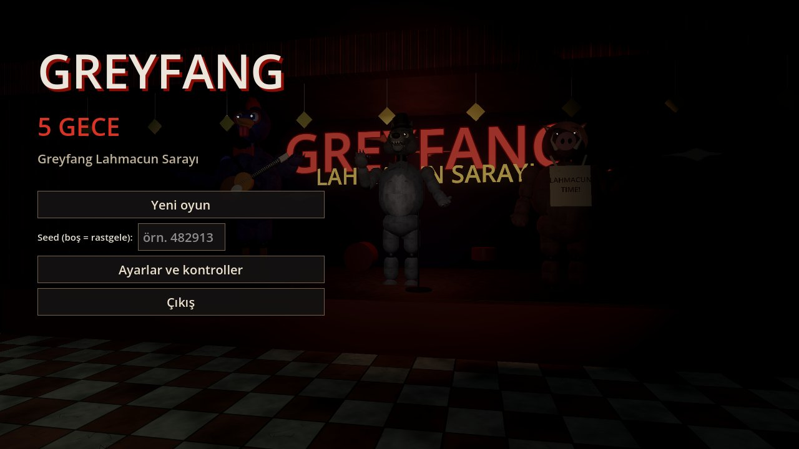

## Ekran görüntüleri

| | |
|---|---|
| 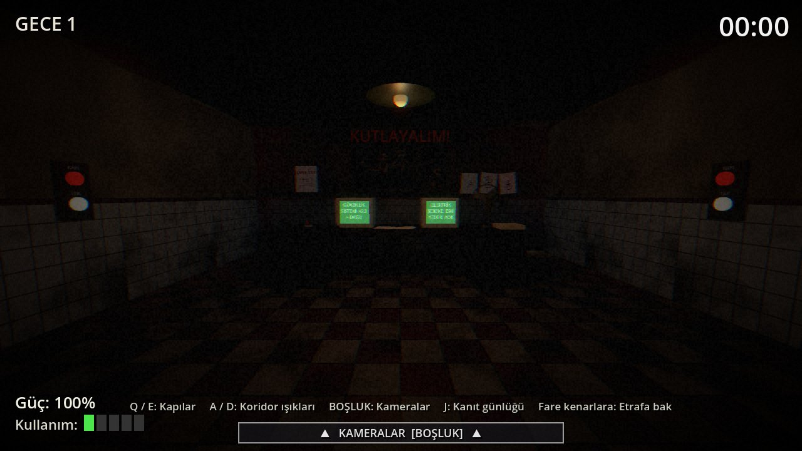 | 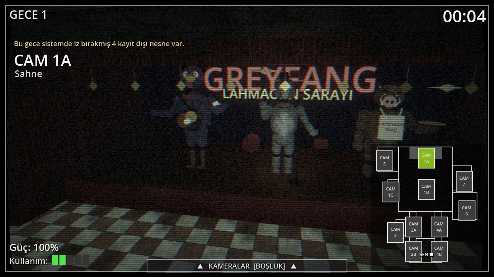 |
| 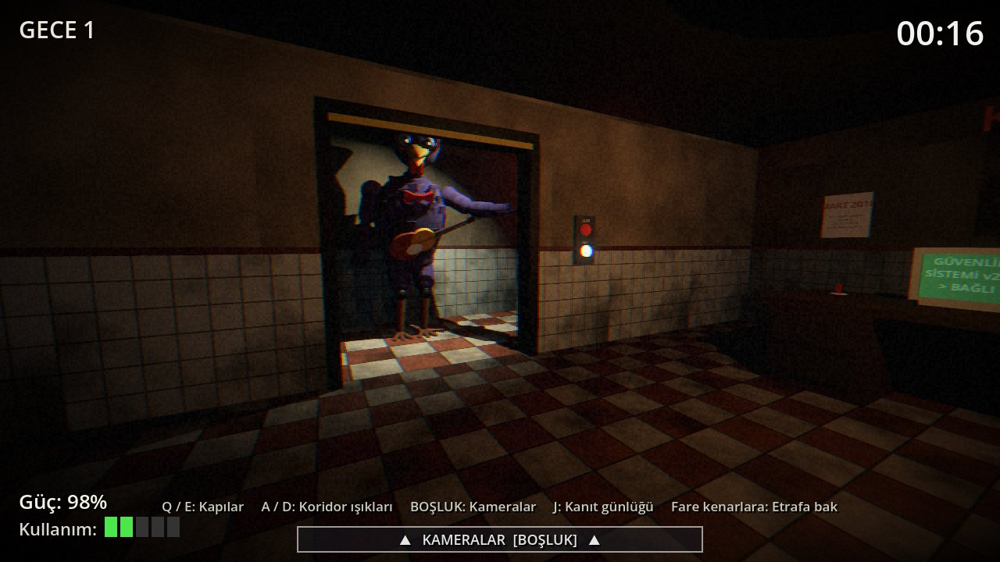 | 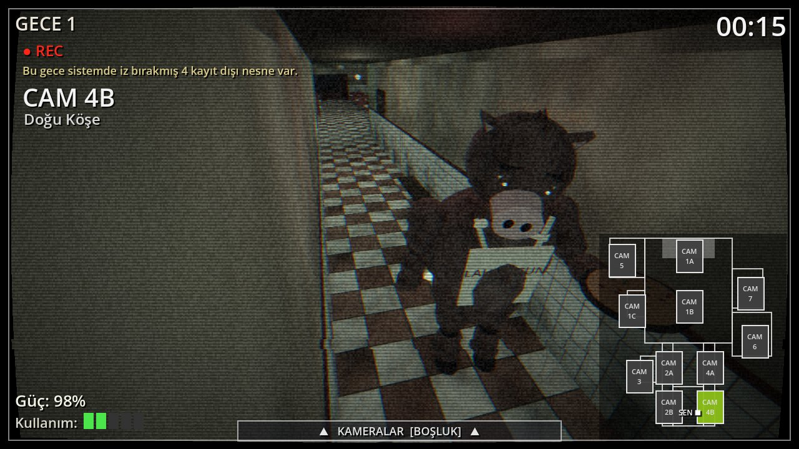 |
| 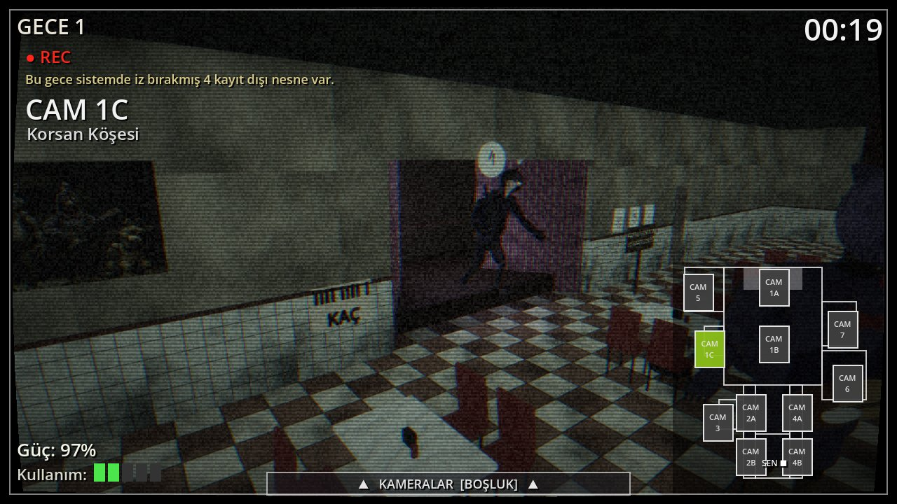 | 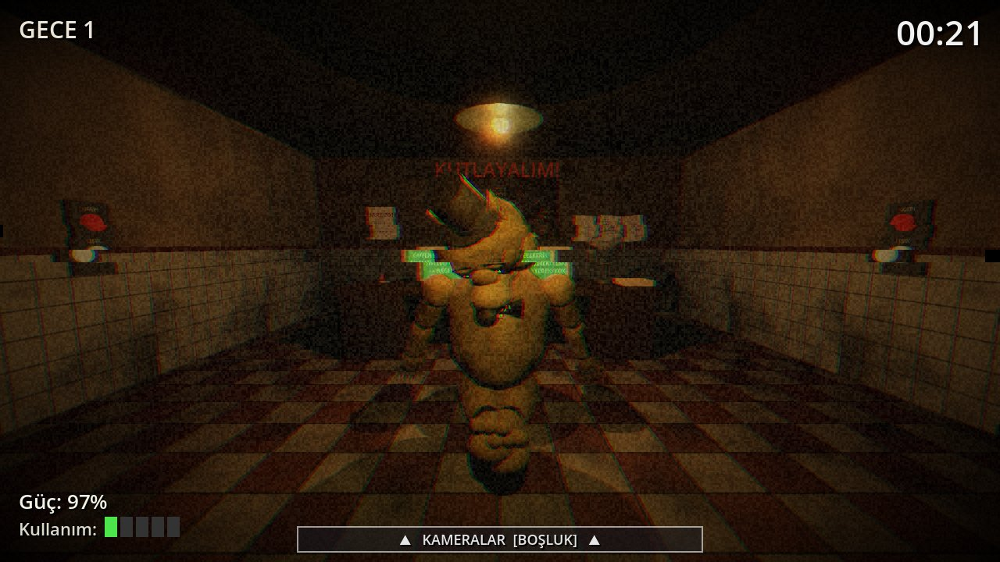 |
| 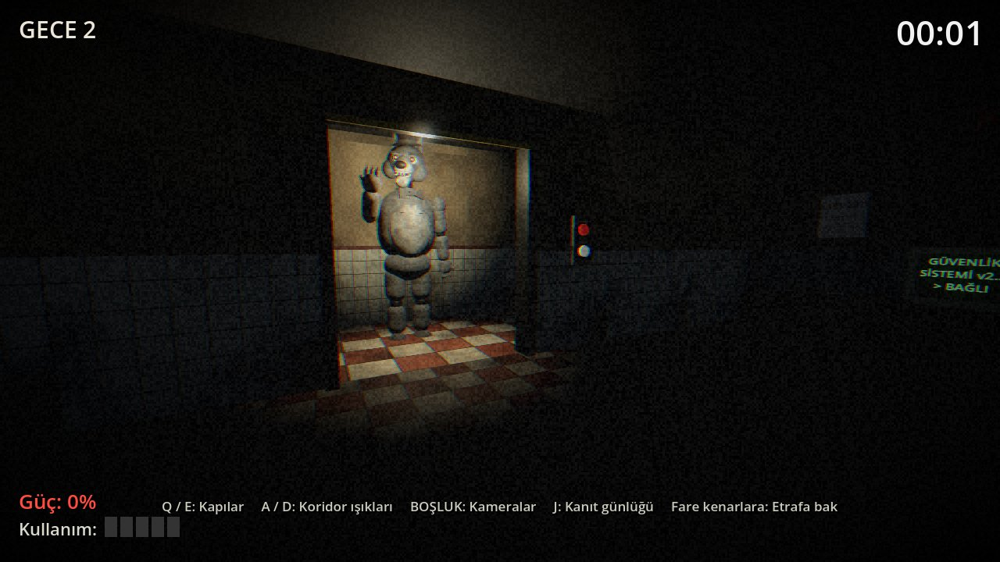 | 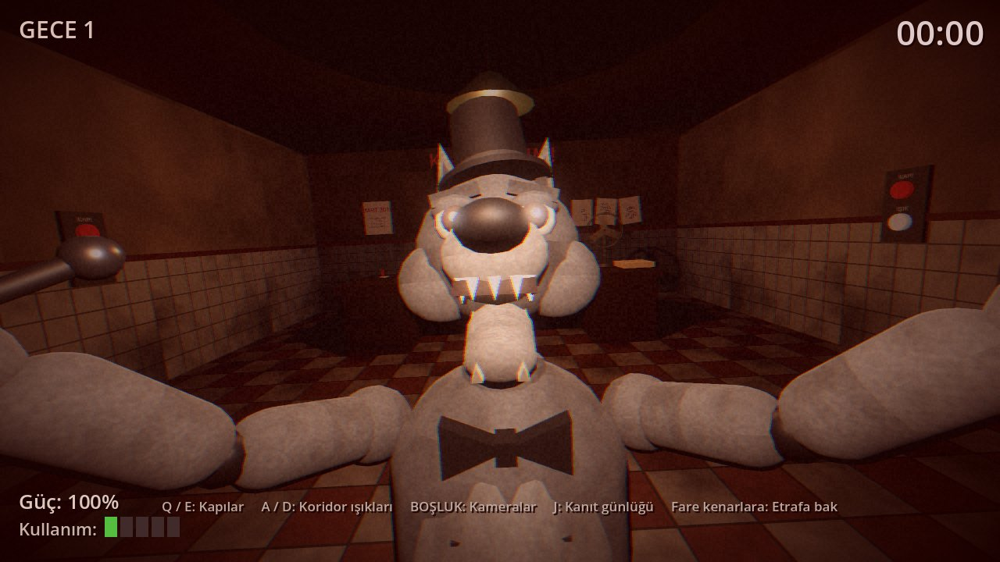 |
| 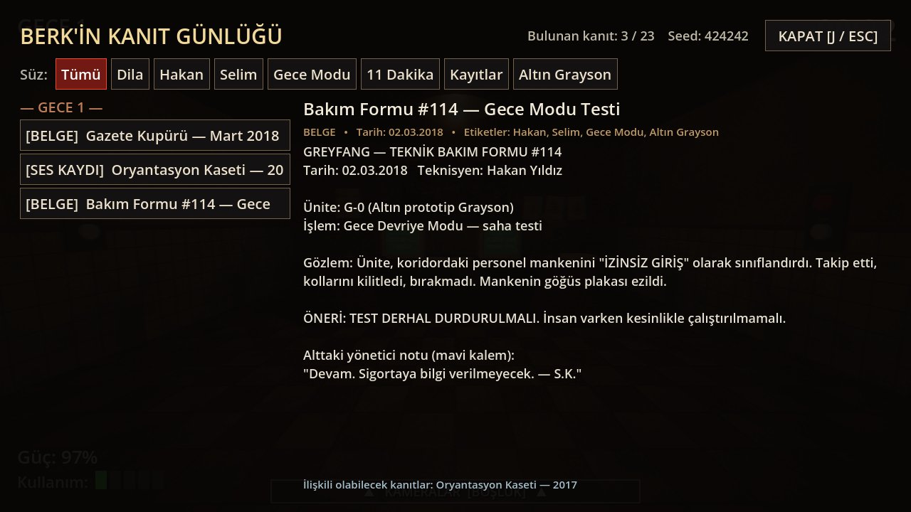 | 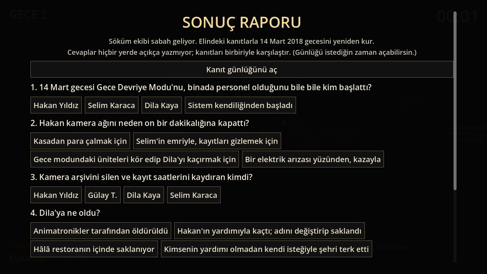 |

## Hikâye

14 Mart 2018 gecesi Greyfang Lahmacun Sarayı'nın güvenlik kameraları 11 dakika boyunca karardı. Kasiyer Dila ortadan kayboldu, gece teknisyeni Hakan sistemi bozmakla suçlandı ve restoran kapandı.

Sekiz yıl sonra Hakan'ın oğlu **Berk** (22) aynı restoranda gece güvenlik görevlisi olarak işe başlar. Hem para kazanmak hem de babasının adını temize çıkarmak istiyor. Beş gece boyunca eski kamera kayıtlarını, bozuk ses kasetlerini, bakım formlarını ve silinmiş sistem komutlarını bulup gerçeği kendisi birleştirmek zorunda.

## Animatronikler

- **Grayson** (gri kurt): grubun lideri; silindir şapka, papyon, mikrofon. Kamerada izlendiği sürece donar, arkanı döndüğünde ilerler.
- **Benny Beak** (mor-mavi horoz, gitarlı): batı koridorundan gelir. Kameradan kaybolduğunda sol kapıyı kontrol et.
- **Brutus** (dişi yaban domuzu, lahmacun tepsili): mutfak tarafından gelir. Arızalı kamerada çoğu zaman yalnızca tepsi ve tencere seslerinden takip edilir.
- **Kaptan Rook** (göz bantlı, kancalı korsan karga): perdeli Korsan Köşesi'nde bekler. Uzun süre kontrol edilmezse koşarak saldırır.
- **Golden Grayson** (eskimiş altın kurt): gizli karakter. Nadiren görünür, bozuk hafızasında kayıp gecenin parçalarını taşır.

## Özellikler

- Gerçek 3B restoran: sahne, yemek salonu, Korsan Köşesi, mutfak (taş fırın, ayran dolabı), tuvaletler, depo, bakım odası, koridorlar ve güvenlik ofisi
- Harita arayüzlü 11 güvenlik kamerası, parazit ve bozulma efektleri
- Sınırlı elektrik: kapılar, koridor ışıkları ve kamera akım harcar; elektrik bitince FNAF'taki gibi bir kesinti sahnesi başlar
- Her animatroniğin kendi rotası, sesleri, yapay zekâsı ve jumpscare'i; zorluk her gece artar
- **Seed tabanlı rastgele kanıt sistemi:** 23 kanıt (belge, kaset, kamera kaydı, sistem kaydı, çevresel iz, bozuk hafıza). Her oyunda farklı yerlerde ve farklı sırayla çıkar. Kaçırılan kritik kanıtlar sonraki gecelerde başka bir yerde yeniden çıkar.
- Kanıtları etiketlerle süzebileceğin kanıt günlüğü; 5. gecenin sonunda sonuç raporu ve **3 farklı son**
- Tüm sesler ve dokular prosedürel olarak üretilmiştir; harici telifli varlık içermez

## Nasıl oynanır / kurulum

1. **[Godot 4.7](https://godotengine.org/download)** sürümünü indir (ücretsiz).
2. Bu depoyu indir: yeşil **Code → Download ZIP** düğmesine bas ya da `git clone` ile klonla.
3. Godot'yu aç, **Import** ile klasördeki `project.godot` dosyasını seç ve **F5** ile oyunu başlat.
   Windows'ta Godot Steam sürümünü kullanıyorsan `Greyfang.bat` dosyasına çift tıklaman da yeterli.

### Kontroller

| Tuş | İşlev |
|---|---|
| **Q / E** | Sol / sağ kapı |
| **A / D** | Sol / sağ koridor ışığı |
| **BOŞLUK** (veya fareyi alttaki çubuğun üstüne getir) | Kamera tableti |
| Haritaya tıkla, **← / →** | Kamera değiştir |
| Kamerada şüpheli nesneye **sol tık** | Kanıtı kaydet |
| Fareyi ekran kenarına götür, **← / →** | Ofiste sola/sağa bak |
| **J / TAB** | Kanıt günlüğü (gece devam eder!) |
| **ENTER** | Telefon mesajını geç |
| **ESC** | Duraklat |

### Tanıtım oynanışı (video için)

`Showcase.bat` dosyası ya da `godot --path . --fullscreen -- --showcase` komutu, oyunun tüm özelliklerini altyazılarla gösteren yaklaşık 2,5 dakikalık otomatik bir oynanış başlatır. Ekran kaydı almak için hazırdır. ESC ile çıkılır.

## Geliştiriciler için

```
scenes/main.tscn             tek sahne; her şey koddan kurulur
scripts/main.gd              oyun akışı, menüler, sonuç raporu, testler, tanıtım
scripts/night_controller.gd  gece: zaman, güç, kapılar, kameralar, yapay zekâ, jumpscare
scripts/world_builder.gd     3B restoran, ofis, kameralar, ışıklar
scripts/animatronic.gd       eklemli prosedürel karakter modelleri ve animasyonları
scripts/clue_system.gd       seed'li kanıt yerleşimi
scripts/story_data.gd        hikâye, kanıt metinleri, sonlar
tools/gen_audio.py           tüm sesleri sentezler (numpy)
tools/gen_textures.py        dokuları üretir (numpy + Pillow)
```

Otomatik testler:

```
godot --headless --path . -- --cluetest   # 300 seed: determinizm ve kritik kanıtların erişilebilirliği
godot --headless --path . -- --simtest    # bot oyuncularla zorluk dengesi
godot --path . -- --flowtest              # 5 geceyi uçtan uca oynar
godot --path . -- --autoshot              # ekran görüntülerini _shots/ içine kaydeder
```

Katkılara açığız: hata bildirimi (issue) aç ya da pull request gönder.

## Notlar

- 3B modeller, karakter konsept çizimine göre koddan kurulmuş geçici modellerdir. Sesler sentezlenmiştir; kasetlerdeki konuşmalar bilerek anlaşılmaz bırakılmış "bozuk bant" mırıltısıdır, söylenenler altyazı olarak verilir.
- Bu oyun bağımsız bir hayran yapımıdır ve Scott Cawthon, *Five Nights at Freddy's* veya Steel Wool Studios ile hiçbir bağlantısı yoktur. Tüm karakterler, mekân ve hikâye özgündür.

## Lisans ve yapımcı

[MIT Lisansı](LICENSE). Özgürce kullanabilir, değiştirebilir ve paylaşabilirsin.

Yapımcı: **Eftelix**. 📺 [YouTube: @eftelix](https://www.youtube.com/@eftelix)

<sub>Anahtar kelimeler: FNAF, Five Nights at Freddy's tarzı oyun, Türk korku oyunu, Türkçe korku oyunu, animatronik, fan game, Godot 4, açık kaynak oyun, indie horror, lahmacun, Greyfang, 5 Gece, Turkish horror game, open source horror game</sub>
